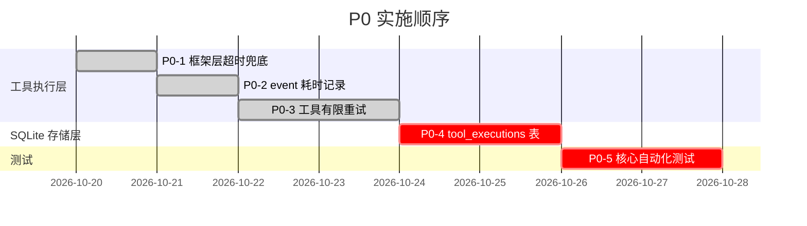

# nanobot 源码审查报告

> 审查日期：2026-10-19
> 审查目标：为 Agent 工具执行可靠性增强与结构化执行记录提供源码级依据
> 审查范围：nanobot v0.3.5 本地源码（`f:\nanobot-main\nanobot-main\`）
> **行号验证说明**：本报告所有行号均通过二次 `Grep` / `Read` 确认，关键断言经过源码交叉验证（含 Provider 重试、Recovery phase 校验、execution.py event 结构、SQLite schema 等）

---

## 一、项目基本信息与技术栈

### 1.1 仓库元信息

| 项目 | 值 |
| --- | --- |
| 仓库地址 | https://github.com/HKUDS/nanobot |
| 当前版本 | 0.3.5（开发中，Alpha 阶段） |
| Python 要求 | ≥ 3.11 |
| 依赖管理 | hatchling + pyproject.toml |
| License | MIT |
| **Git 状态** | ⚠️ **非 Git 仓库**（本地副本不含 `.git` 目录） |
| 构建后端 | hatchling |
| CLI 入口 | `nanobot.cli.entry:main`（脚本名 `nanobot`） |
| TUI 入口 | `nanobot.cli.desktop_tui:main`（脚本名 `nanobot-desktop-tui`） |

### 1.2 核心依赖

| 依赖 | 版本约束 | 用途 |
| --- | --- | --- |
| `typer` | ≥0.20.0 | CLI 框架 |
| `pydantic` | ≥2.12.0 | 数据模型/配置校验 |
| `anthropic` | ≥0.100.0 | Anthropic Provider SDK |
| `openai` | ≥2.8.0 | OpenAI-compatible Provider SDK |
| `httpx[socks]` | ≥0.28.0 | HTTP 客户端 |
| `aiohttp` | ≥3.14.3 | 异步 HTTP / WebSocket |
| `loguru` | ≥0.7.3 | 日志框架 |
| `rich` | ≥14.0.0 | TUI 渲染 |
| `prompt-toolkit` | ≥3.0.52 | 命令行交互 |
| `croniter` | ≥6.0.0 | Cron 调度 |
| `mcp` | ≥1.26.0 | Model Context Protocol SDK |
| `tiktoken` | ≥0.12.0 | Token 估算 |
| `dulwich` | ≥0.24.0 | 内嵌 Git 操作 |
| `filelock` | ≥3.25.2 | 文件锁 |
| `watchfiles` | ≥1.1.1 | 配置热更新 |
| `pyyaml` | ≥6.0 | YAML 配置 |
| `jinja2` | ≥3.1.0 | Prompt 模板 |
| `qrcode[pil]` | ≥8.0 | 二维码生成 |

### 1.3 开发工具链

| 工具 | 版本 | 用途 |
| --- | --- | --- |
| `hatchling` | — | 构建后端 |
| `pytest` | ≥9.0.0 | 测试框架 |
| `pytest-asyncio` | ≥1.3.0 | 异步测试 |
| `pytest-xdist` | ≥3.8.0 | 并行测试 |
| `pytest-cov` | ≥6.0.0 | 覆盖率 |
| `ruff` | ≥0.1.0 | Lint |
| `basedpyright` | ≥1.39.0 | 类型检查（strict 模式） |
| `hatch_build.py` | — | 自定义构建钩子 |

### 1.4 顶层目录结构

```
nanobot-main/
├── nanobot/                  # Python 核心包
│   ├── agent/                # Agent 主循环、Runner、工具系统
│   │   ├── tools/            # 工具实现（shell, filesystem, mcp, web, self...）
│   │   ├── loop.py           # AgentLoop：核心处理引擎
│   │   ├── runner.py         # AgentRunner：共享执行循环
│   │   ├── model_runtime.py   # ModelRuntimeResolver
│   │   ├── hook.py           # AgentHook / AgentTurnHook
│   │   └── ...
│   ├── session/              # Session 管理、SQLite 存储、Recovery
│   │   ├── sqlite_store.py   # SqliteSessionStore：事务性 SQLite
│   │   ├── recovery.py       # Checkpoint 恢复逻辑
│   │   ├── goal_state.py     # Goal 状态管理
│   │   ├── manager.py        # Session / SessionManager
│   │   └── ...
│   ├── providers/            # LLM Provider 抽象与实现
│   │   ├── base.py           # LLMProvider 基类 + 重试/流式
│   │   ├── factory.py        # Provider 工厂
│   │   └── ...
│   ├── gateway/              # Gateway 服务运行时
│   ├── channels/             # 消息渠道（Slack/Discord/飞书/微信/Telegram...）
│   ├── cli/                  # CLI 命令实现
│   ├── config/               # 配置加载/校验
│   ├── bus/                  # 消息总线（EventBus）
│   ├── tools/                # 顶层 tools 包（测试）
│   ├── skills/               # Skill 定义
│   ├── templates/            # Agent/Prompt 模板
│   ├── utils/                # 通用工具库
│   ├── webui/                # WebUI HTTP/WebSocket 端点（Python）
│   ├── llm_usage/            # LLM 调用用量追踪
│   ├── cron/                 # Cron 调度
│   ├── triggers/             # Local Trigger 调度
│   ├── security/             # 安全策略（workspace 访问、SSRF）
│   └── __main__.py           # 入口
├── webui/                    # WebUI 前端（React + Bun）
├── tui/                      # TUI 前端（TypeScript + Bun）
├── tests/                    # Python 测试
│   ├── agent/                # Agent 层测试（含 recovery/runner/loop）
│   ├── session/              # Session 层测试（含 recovery/sqlite_schema）
│   ├── tools/                # 工具层测试
│   ├── providers/            # Provider 层测试
│   └── ...
├── docs/                     # 文档（markdown）
├── scripts/                  # 构建/安装脚本
├── Dockerfile                # Docker 构建
├── pyproject.toml            # 依赖/构建配置
└── README.md / CONTRIBUTING.md / LICENSE
```

### 1.5 配置与运行时数据位置

| 资源 | 默认位置 | 说明 |
| --- | --- | --- |
| 配置文件 | `~/.nanobot/config.yaml`（平台相关） | 通过 `config/paths.py` 解析 |
| Session 存储 | `<runtime_data_dir>/sessions/sessions.sqlite3` | WAL 模式 SQLite |
| 运行时数据 | `config.runtime_data_dir`（可配置） | 含 sessions、缓存 |
| 日志 | 控制台 + 可选文件 | loguru 驱动 |
| Exec 会话内存 | `ExecSessionManager`（进程内，max 8 sessions） | 不持久化到 SQLite |

---

## 二、本地运行、构建和测试方式

### 2.1 安装

```bash
# 开发模式安装
pip install -e ".[dev]"

# 或使用 hatch
hatch env create
hatch run pip install -e ".[dev]"
```

### 2.2 启动

```bash
# Gateway 模式（含 WebUI）
nanobot gateway

# 仅 CLI 交互
nanobot chat

# TUI 桌面应用
nanobot-desktop-tui

# Docker
docker compose up
```

### 2.3 测试

```bash
# 运行全部测试
pytest

# 指定目录
pytest tests/agent/ -v
pytest tests/session/ -v

# 并行执行
pytest -n auto

# 覆盖率（目标 75%）
pytest --cov=nanobot --cov-fail-under=75

# 类型检查
basedpyright nanobot

# Lint（自动发现）
ruff check nanobot tests
```

### 2.4 CI

`.github/workflows/ci.yml` — GitHub Actions 自动运行 pytest、ruff、basedpyright。

---

## 三、核心目录结构与架构图

### 3.1 核心调用链图（Mermaid）

```mermaid
sequenceDiagram
    participant User as 用户消息
    participant Bus as MessageBus
    participant Loop as AgentLoop
    participant Session as Session<br/>(SessionManager)
    participant Runner as AgentRunner
    participant Provider as LLMProvider
    participant Exec as execute_tool_calls
    participant Tool as 具体 Tool 实现

    User->>Bus: InboundMessage
    Bus->>Loop: enqueue_session_message
    Loop->>Session: state.get(key)
    Session-->>Loop: Session 对象（含 history, metadata）
    
    Note over Loop: 构造 TurnContext<br/>绑定 RequestContext<br/>准备 Prompt

    Loop->>Runner: AgentRunSpec.run()
    Runner->>Session: checkpoint(pending_user_turn)

    loop for iteration in range(max_iterations)
        Runner->>Provider: chat_stream_with_retry(messages, tools)
        Note over Provider: 指数退避重试<br/>(1s, 2s, 4s)
        Provider-->>Runner: LLMResponse
        
        alt response.should_execute_tools
            Runner->>Session: checkpoint(awaiting_tools)
            Runner->>Exec: execute_tool_calls(tool_calls, concurrent)
            
            loop for each tool_call
                Exec->>Tool: prepare_call → tool.execute(**params)
                alt 成功
                    Tool-->>Exec: str | ToolResult.ok
                    Exec->>Runner: result, event{name,status:"ok",detail}
                else Exception / ToolResult.error
                    Tool-->>Exec: 异常或错误
                    Exec->>Runner: result, event{name,status:"error",detail}
                end
            end
            
            Exec-->>Runner: [results], [events]
            Runner->>Session: checkpoint(tools_completed)
        else 最终响应
            Runner->>Session: checkpoint(final_response)
        end
    end
    
    Runner-->>Loop: AgentRunResult
    Loop->>Session: state.save()
    Loop->>Bus: publish_outbound(OutboundMessage)
    Bus-->>User: 发送回复
```

### 3.2 Checkpoint 恢复流程图（Mermaid）

```mermaid
stateDiagram-v2
    [*] --> final_response
    [*] --> awaiting_tools
    [*] --> tools_completed
    [*] --> error
    
    state final_response {
        assistant_message: {content, role}
        completed_tool_results: []
        pending_tool_calls: []
    }
    
    state awaiting_tools {
        assistant_message: {tool_calls: [...]}
        completed_tool_results: []
        pending_tool_calls: [全部待执行]
    }
    
    state tools_completed {
        assistant_message: {tool_calls: [...]}
        completed_tool_results: [全部已完成]
        pending_tool_calls: []
    }
    
    state error {
        phase: "error"
        # 当前无明确 producer contract
    }
    
    awaiting_tools --> interrupted: checkpoint_is_well_formed()
    tools_completed --> restored: checkpoint_is_well_formed()
    final_response --> restored: checkpoint_is_well_formed()
    
    state interrupted {
        # pending tool calls 变成<br/>"Task interrupted before finished"
        # 不会重新执行！
    }
    
    state restored {
        # provider_state 仅在 final_response / tools_completed<br/>且版本同步时保留
    }
```

---

## 四、关键调用链及源码证据

### 4.1 Session 获取与消息持久化

| 步骤 | 文件 | 类/函数 | 行号 |
| --- | --- | --- | --- |
| 1. 消息入队 | `nanobot/agent/loop.py` | `AgentLoop._enqueue_session_message` | ~985-990 |
| 2. 获取/创建 Session | `nanobot/session/manager.py` | `SessionManager.state.get(key)` | — |
| 3. 加载 SQLite 记录 | `nanobot/session/sqlite_store.py` | `SqliteSessionStore.load(key)` | L218-240 |
| 4. 预持久化用户消息 | `nanobot/agent/loop.py` | `AgentLoop._persist_user_message_early` | L709-749 |
| 5. 写入 SQLite | `nanobot/session/sqlite_store.py` | `SqliteSessionStore.save()` | L281-300 |

### 4.2 Agent 主循环与模型调用

| 步骤 | 文件 | 类/函数 | 行号 |
| --- | --- | --- | --- |
| 1. 构造 AgentRunSpec | `nanobot/agent/loop.py` | `AgentLoop._run_agent_loop` | L1035-1081 |
| 2. 启动 Runner | `nanobot/agent/runner.py` | `AgentRunner.run(spec)` | L308-377 |
| 3. 核心迭代循环 | `nanobot/agent/runner.py` | `AgentRunner._run_core` | L408-876 |
| 4. 请求模型 | `nanobot/agent/runner.py` | `AgentRunner._request_model` | L908-1108 |
| 5. Provider 重试入口 | `nanobot/providers/base.py` | `LLMProvider.chat_stream_with_retry` | L1225-1292 |
| 6. 重试核心逻辑 | `nanobot/providers/base.py` | `LLMProvider._run_chat_with_retry` | 需进一步确认 |
| 7. 指数退避延迟 | `nanobot/providers/base.py` | `_CHAT_RETRY_DELAYS = (1, 2, 4)` | L349 |

### 4.3 工具执行链

| 步骤 | 文件 | 类/函数 | 行号 |
| --- | --- | --- | --- |
| 1. Runner 调用工具执行器 | `nanobot/agent/runner.py` | `AgentRunner._run_core` | L562-572 |
| 2. 批量执行入口 | `nanobot/agent/tools/execution.py` | `execute_tool_calls()` | L49-104 |
| 3. 分批逻辑（concurrency_safe） | `nanobot/agent/tools/execution.py` | `_partition_tool_batches()` | L286-309 |
| 4. 单个工具执行 | `nanobot/agent/tools/execution.py` | `_execute_tool_call()` | L107-216 |
| 5. 参数校验/转换 | `nanobot/agent/tools/registry.py` | `ToolRegistry.prepare_call()` | L122-159 |
| 6. 工具实际执行 | `nanobot/agent/tools/registry.py` | `tool.execute(**params)` | L165-167 |
| 7. Hook 回调 | `nanobot/agent/tools/execution.py` | `hook.before_execute_tool / on_execute_tool_error / after_execute_tool` | L158, L171, L190, L208 |

### 4.4 Checkpoint 写入位置

| Phase | 写入位置 | 文件:行号 |
| --- | --- | --- |
| `awaiting_tools` | Runner._run_core 工具调用前 | `runner.py:548-558` |
| `tools_completed` | Runner._run_core 工具执行后 | `runner.py:604-618` |
| `final_response` | Runner._run_core 最终响应前 | `runner.py:813-824` |
| Checkpoint 结构 | loop._checkpoint() 闭包 | `loop.py:1066-1080` |

Checkpoint 包含字段：
```python
{
    "phase": "awaiting_tools" | "tools_completed" | "final_response",
    "iteration": int,
    "model": str,
    "assistant_message": dict,       # 完整 assistant 消息（含 tool_calls）
    "completed_tool_results": [...],  # 已完成的 tool 消息行
    "pending_tool_calls": [...],      # 待执行的 tool_call
    "provider_state": dict | None,     # ProviderConversationState checkpoint
}
```

---

## 五、已有能力与实际缺口

### 5.1 已有能力（框架层已实现）

| 能力 | 位置 | 说明 |
| --- | --- | --- |
| ✅ Provider 指数退避重试 | `providers/base.py:349,1225-1292` | `_CHAT_RETRY_DELAYS = (1, 2, 4)`，区分可重试/不可重试 |
| ✅ 结构化错误分类 | `providers/base.py:320-326,733-890` | `error_kind` / `error_type` / `error_code` / `error_should_retry` |
| ✅ RetryAfter 解析 | `providers/base.py` | 读取 Provider 响应头/错误消息中的 retry-after |
| ✅ Provider 层流式超时 | `providers/base.py:38-71,1106-1117` | `DEFAULT_STREAM_IDLE_TIMEOUT_S = 90`（可通过 env 配置） |
| ✅ Shell 工具内部超时 | `tools/exec_session.py:173,256-279` | `max_runtime` + `idle_timeout`，独立监控任务 |
| ✅ MCP 工具超时 | `tools/mcp.py:611-650` | 默认 30s，用 `asyncio.wait_for()` 包装 |
| ✅ SSRF / Workspace 安全边界 | `tools/execution.py:219-274` | 硬边界，不可绕过 |
| ✅ Concurrency 控制 | `tools/base.py:250-258, execution.py:286-309` | `read_only` + `exclusive` 属性决定是否可并发 |
| ✅ Checkpoint 持久化 | `session/sqlite_store.py:58-61` | `checkpoints` 表，session_key 唯一 |
| ✅ Recovery（进程崩溃） | `session/recovery.py:278-373` | pending tool calls 变成"interrupted"，不重放 |
| ✅ ProviderConversationState 保留 | `session/recovery.py:348-368` | 仅在 checkpoint 版本同步时保留 |
| ✅ ExecSessionManager | `tools/exec_session.py:407-661` | 进程级会话管理，支持 kill/shutdown |
| ✅ 工具事件收集 | `runner.py:573, execution.py:122-126,216` | `tool_events: list[dict]`（**但只有 name/status/detail**） |
| ✅ LLMCallRecord 观测 | `providers/base.py:544-578` | 每次 Provider 调用的耗时/用量/错误状态码 |
| ✅ Session 版本控制 | `session/sqlite_store.py:50,257-279` | `revision` + `generation` 避免并发冲突 |
| ✅ Pending Followups 日志 | `session/recovery.py:64-104` | WebUI follow-up 持久化到 session.metadata |

### 5.2 实际缺口（需要补充）

| 缺口 | 现状 | 影响范围 | 证据 |
| --- | --- | --- | --- |
| ❌ **工具执行无框架层统一超时** | Shell/MCP 各自实现，其他工具（filesystem/self/search/web/subagent/cli_apps）无超时 | 所有非 Shell/MCP 工具；框架无法兜底 | 检查全部 20+ 工具文件，无 asyncio.wait_for 包装 |
| ❌ **工具执行无重试机制** | 所有 Exception 直接返回 ToolResult.error，无重试判断 | 瞬态错误（网络/临时资源）不会自动恢复 | `execution.py:168-187`，只有 `SSRF`/`workspace_violation` 分类 |
| ❌ **工具 event 无耗时记录** | event dict 只有 `{name, status, detail}` | 无法诊断慢工具，无法统计 P99 | `execution.py:122-126,172-176,192-196,216` |
| ❌ **无 SQLite tool_execution_log 表** | 只有 sessions/messages/checkpoints/pending_inputs/storage_meta 五张表 | 无法查询"这个 session 的所有工具调用及其结果/耗时" | `sqlite_store.py:46-65`（CREATE TABLE 定义） |
| ❌ **工具调用无唯一幂等键** | ToolCallRequest.id 来自 LLM，但不持久化到独立日志 | 重试时可能对有副作用的操作造成重复执行 | `ToolCallRequest` 在 `providers/base.py:74-118` 定义，但 execution.py 不记录 |
| ❌ **execution.py 不计时** | 执行前后无 time.monotonic() 记录 | event 中无法携带 elapsed_s | `execution.py` 全文无 elapsed/duration/latency 相关 |
| ❌ **cancelled 后的状态不一致** | execution.py:168-169 捕获 CancelledError 并 raise，event 不记录 | 取消时 tool_events 缺失 | execution.py try/except 块结构 |
| ❌ **subagent 执行无事件记录** | SubagentManager 独立于 execute_tool_calls | subagent 任务的工具调用不在 tool_events 中 | 需进一步确认 |
| ❌ **无框架层错误分类** | execution.py 只做 SSRF/workspace 分类，其他 Exception 一律 `"Error: Type: message"` | 无法对超时/连接错误做差异化处理 | `execution.py:170-187` |
| ❌ **无故障注入测试** | 未发现 fault injection 框架 | 重试耗尽/重复副作用/恢复失败场景不可覆盖 | 搜索 pytest fixture 无 fault/mock-retry 相关 |
| ❌ **Provider 超时与工具超时独立** | Provider 层 90s idle timeout，工具层各自实现，互不关联 | 长任务中两者可能冲突 | `DEFAULT_STREAM_IDLE_TIMEOUT_S = 90` vs `ExecToolConfig.max_runtime = 3600` |
| ❌ **max_iterations 与工具超时无关联** | AgentRunner 用 `range(max_iterations)` 控制循环（默认由 AgentDefaults 决定），但不因单次工具执行超时动态调整 | 一个慢工具可能耗尽全部迭代预算 | `AgentRunSpec.max_iterations` 与工具执行无直接关联 |

---

## 六、工具执行可靠性设计

### 6.1 统一超时方案

#### 现状分析

**当前超时覆盖情况**：

| 层级 | 超时机制 | 覆盖范围 | 问题 |
| --- | --- | --- | --- |
| Provider | `asyncio.wait_for` + `DEFAULT_STREAM_IDLE_TIMEOUT_S=90s` | LLM 流式调用 | ✅ 统一有效 |
| Shell 工具 | `_watch_timeout` 独立 task + `max_runtime` | 子进程执行 | ✅ 有 kill 逻辑，真实终止进程 |
| MCP 工具 | `asyncio.wait_for(timeout=30s)` | MCP SDK 调用 | ✅ 有 TimeoutError 捕获 |
| CLI Apps | `asyncio.wait_for(timeout=cfg.run_timeout)` | 子进程 CLI 应用 | ✅ 有超时 |
| 其他工具 | **无** | filesystem/self/search/web/subagent/message/sessions | ❌ 完全无超时兜底 |

#### 为什么单纯 `asyncio.wait_for()` 不够

1. **Shell 子进程无法用 wait_for 真正终止**：`asyncio.wait_for` 超时后 cancel 协程，但 `ExecSession._completion_task` 监控的子进程仍在运行。`ExecSessionManager` 有独立的 kill 机制，但这是工具内部实现，框架层 wait_for 无法知道。
2. **MCP SDK 内部有自己的取消作用域**：`mcp.py:647` 注释提到 "MCP SDK's anyio cancel scopes can leak CancelledError on timeout/failure"。外层 wait_for 与 SDK 内部取消可能冲突。
3. **HTTP 请求的超时边界模糊**：如果框架层对 web 工具加 wait_for，而 httpx 客户端也有 timeout，两层超时可能叠加或竞态。
4. **副作用已发生的工具无法安全重试**：即使 wait_for 超时，数据库插入/文件写入/外部 API 调用等副作用可能已经发生。wait_for 只取消协程，不回滚副作用。

#### 推荐方案：分层超时 + 执行状态记录

**不改动现有工具的内部超时逻辑**，而是在 `execution.py` 的 `_execute_tool_call()` 包装器层增加：

```python
# execution.py 增强点（设计，非现有代码）
async def _execute_tool_call(tools, tool_call, ...) -> tuple[Any, dict]:
    start = time.perf_counter()
    event = {"name": tool_call.name, "status": "pending", "start_ms": ...}
    
    try:
        # 方案 1：有副作用的工具不加框架层 wait_for，让工具内部自行管理
        #   → shell/exec_session/mcp 已有内部超时
        #   → filesystem/self 等无副作用工具可加统一 wait_for
        
        result = await asyncio.wait_for(
            tool.execute(**params),
            timeout=_resolve_tool_timeout(tool, tool_call),  # 框架层默认 + 工具覆盖
        )
        elapsed = time.perf_counter() - start
        event = {..., "status": "ok", "elapsed_ms": int(elapsed*1000)}
        
    except asyncio.TimeoutError:
        elapsed = time.perf_counter() - start
        event = {..., "status": "timeout", "elapsed_ms": int(elapsed*1000),
                "error_kind": "timeout", "attempt": 1, "max_attempts": 1}
        # 关键：不重试！超时 = 结果未知 = 不自动重试有副作用工具
        return ToolResult.error("Error: Tool execution timed out"), event
        
    except asyncio.CancelledError:
        elapsed = time.perf_counter() - start
        event = {..., "status": "cancelled", "elapsed_ms": int(elapsed*1000),
                "error_kind": "cancelled"}
        raise  # 保持现有行为：cancelled 向上传播
    except Exception as exc:
        elapsed = time.perf_counter() - start
        error_kind = _classify_tool_exception(exc)  # 复用 Provider 层的分类逻辑
        event = {..., "status": "error", "elapsed_ms": int(elapsed*1000),
                "error_kind": error_kind, "error_type": type(exc).__name__}
        # 可重试的瞬态错误 → 有限重试（见 6.2）
        ...
```

### 6.2 有限重试方案

#### 与 Provider 重试的独立边界

| 维度 | Provider 层 | 工具执行层 |
| --- | --- | --- |
| 重试对象 | LLM API 请求 | Tool.execute() 调用 |
| 最大次数 | 由 `_CHAT_RETRY_DELAYS` 决定（隐式，需看 `_run_chat_with_retry` 实现确认） | **建议 2 次（含首次）** |
| 退避策略 | 指数 (1,2,4) | 线性或固定抖动（建议 1s + rand(0,0.5s)） |
| 有副作用保护 | N/A（LLM API 是幂等请求） | **关键边界：有副作用工具不重试** |
| 429 特殊处理 | 区分可重试 vs 不可重试（quota/billing） | N/A（工具层不涉及 rate limit） |

#### 错误分类映射

复用 Provider 层已有的分类框架（`providers/base.py:733-787` 的 `_error_response_from_exception` 逻辑），但映射到工具执行上下文：

| 分类 | 判断依据 | 可重试？ | 适用工具 |
| --- | --- | --- | --- |
| `ssrf_violation` | error 文本含 SSRF marker | ❌ | 全部（硬边界） |
| `workspace_violation` | error 文本含 workspace marker | ❌ | 全部（硬边界） |
| `timeout` | asyncio.TimeoutError | ❌ 结果未知 | 全部 |
| `connection` | httpx.ConnectError / aiohttp.ClientConnectionError | ✅（仅限只读工具） | search/web/mcp |
| `temporary_resource` | ResourceWarning / IOError(EBUSY) / OSError(暂时) | ✅（仅限只读工具） | filesystem/search |
| `permanent` | FileNotFoundError / PermissionError / ValidationError | ❌ | 全部 |
| `cancelled` | asyncio.CancelledError | ❌（由上层处理） | 全部 |
| `unknown` | 其他 Exception | ❌ 保守策略 | 全部 |

#### 副作用保护机制

```python
# 设计方案，非现有代码
def _is_side_effect_tool(tool_name: str) -> bool:
    """已知有外部副作用的工具名单。"""
    return tool_name in {
        "exec", "exec_session",           # 子进程执行
        "apply_patch",                    # 文件系统写操作
        "edit_file", "write_file",        # 文件系统写操作
        "create_file", "delete_file",     # 文件系统写操作
        "web_search",                     # 无副作用（只读）
        # 注意：read_only=True 的工具（filesystem read, search, list_exec_sessions）天然安全
    }

# 重试条件：
# 1. 错误分类为 connection / temporary_resource
# 2. 工具不标记为 side_effect_tool（保守：默认只读工具才重试）
# 3. 尝试次数 < max_tool_retries（建议配置，默认 1 次重试 = 2 次总尝试）
```

### 6.3 幂等性与执行状态

#### 当前状态

- `ToolCallRequest.id` 来自 LLM 响应（`providers/base.py:77`），但仅在本次 Runner 迭代中使用，**不持久化**
- `finish_reason="tool_calls"` 时 checkpoint 记录 `pending_tool_calls`（含 id），但恢复时不重放执行（`recovery.py:327-335`）
- 没有"上次已执行到哪一步"的框架层查询接口

#### 风险分析

1. **进程崩溃在 `awaiting_tools` 阶段**：
   - checkpoint 有 pending_tool_calls，但 `restore_runtime_checkpoint()` 把它们变成 "interrupted" 错误消息
   - ✅ 已保护，不会重放
   
2. **checkpoint 写入成功但实际部分工具已执行**：
   - 这是 **最大风险**：如果崩溃发生在某些工具执行完、checkpoint 更新到 `tools_completed` 之前
   - 恢复时 checkpoint 显示 `awaiting_tools`，pending 变成 interrupted
   - 但 **部分工具可能已经产生副作用**（exec 已运行子进程、write_file 已写入）
   - recovery.py 注释提到 "silently dropping a malformed tool result could make the model repeat an external side effect"（L221）
   - **当前没有机制处理这种不一致**

3. **重试时重复执行有副作用工具**：
   - 当前不存在工具重试，所以不是当前风险
   - 但一旦加工具重试，**必须有副作用保护**

#### 执行状态设计（最小可行）

```python
# 新 SQLite 表（设计，非现有代码）
CREATE TABLE IF NOT EXISTS tool_executions (
    id INTEGER PRIMARY KEY AUTOINCREMENT,
    session_key TEXT NOT NULL REFERENCES sessions(key) ON DELETE CASCADE,
    turn_id TEXT NOT NULL,              # 绑定到 InboundMessage metadata 中的 turn_id
    tool_call_id TEXT NOT NULL,         # LLM 生成的 tool_call.id
    tool_name TEXT NOT NULL,
    arguments_json TEXT NOT NULL,       # 完整参数快照（脱敏后）
    side_effect BOOLEAN NOT NULL,       # 是否已知有副作用
    start_ms INTEGER NOT NULL,          # time.monotonic() 偏移
    end_ms INTEGER,                     # NULL = 正在执行 / 崩溃中断
    status TEXT NOT NULL,               # pending | running | ok | error | timeout | cancelled
    error_kind TEXT,                    # 分类见 6.2
    error_type TEXT,                    # Python 异常类型名
    error_message TEXT,                 # 脱敏后的错误文本
    attempt INTEGER NOT NULL DEFAULT 1, # 当前尝试次数
    max_attempts INTEGER NOT NULL DEFAULT 1,
    retry_of INTEGER,                   # 如果是重试，指向首次执行 ID
    output_preview TEXT,                # 结果前 1024 字符（脱敏）
    UNIQUE(session_key, tool_call_id, attempt)  # 防重复重试同一 call_id
);
CREATE INDEX IF NOT EXISTS tool_exec_session ON tool_executions(session_key);
CREATE INDEX IF NOT EXISTS tool_exec_status ON tool_executions(status);
CREATE INDEX IF NOT EXISTS tool_exec_time ON tool_executions(session_key, start_ms);
```

---

## 七、结构化执行记录的数据模型与接口

### 7.1 现有日志来源

| 来源 | 存储位置 | 字段 | 可查询性 |
| --- | --- | --- | --- |
| ✅ LLMCallRecord | 通过 `LLMUsageSource` → SQLite（`llm_usage/store.py`） | duration_ms, provider, model, finish_reason, error_status_code, error_kind | 按 session 聚合 |
| ✅ checkpoint | SQLite `checkpoints` 表 | phase, assistant_message, completed_tool_results, pending_tool_calls | 仅最近一次 |
| ✅ messages | SQLite `messages` 表 | role, content（含 tool 输出行）, position | 按 position 顺序 |
| ❌ tool_events | **仅内存**（AgentRunResult.tool_events） | name, status, detail（截断 120 字符） | Gateway 关闭后丢失 |
| ❌ ExecSessionInfo | **仅内存**（ExecSessionManager._sessions） | session_id, command, elapsed_s, exit_code, finish_reason | 进程关闭后丢失 |
| ❌ ShellOutput | **仅内存**（ExecSession._stdout/_stderr buffer） | stdout, stderr（bounded，MAX_OUTPUT_CHARS） | 进程关闭后丢失 |

### 7.2 新表与现有表的关系

```mermaid
erDiagram
    sessions ||--o{ messages : "has"
    sessions ||--o| checkpoints : "has"
    sessions ||--o{ tool_executions : "has"
    sessions ||--o{ pending_inputs : "has"
    
    messages {
        TEXT session_key PK,FK
        INTEGER position PK
        TEXT record  # JSON: {role, content, tool_call_id, name, ...}
    }
    
    checkpoints {
        TEXT session_key PK,FK
        TEXT record  # JSON: {phase, assistant_message, completed_tool_results, pending_tool_calls}
    }
    
    sessions {
        TEXT key PK
        TEXT metadata  # JSON: 含 goal_state, recovery, pending_followups 等
        TEXT provider_state
        INTEGER revision
        TEXT generation
    }
    
    tool_executions {
        INTEGER id PK
        TEXT session_key FK
        TEXT turn_id
        TEXT tool_call_id
        TEXT tool_name
        TEXT arguments_json
        BOOLEAN side_effect
        INTEGER start_ms
        INTEGER end_ms
        TEXT status
        TEXT error_kind
        TEXT error_type
        INTEGER attempt
    }
```

### 7.3 WebUI / API 查询接口（P1 设计）

```python
# 新增 SessionState 异步方法（设计）
class SessionState:
    async def list_tool_executions(
        self,
        session_key: str,
        *,
        status_filter: str | None = None,       # ok | error | timeout | cancelled
        tool_name_filter: str | None = None,
        turn_id_filter: str | None = None,
        time_range: tuple[float, float] | None = None,  # monotonic offset
        limit: int = 100,
    ) -> list[ToolExecutionRecord]: ...
    
    async def get_tool_execution(
        self,
        execution_id: int,
    ) -> ToolExecutionRecord | None: ...
    
    async def summarize_tool_usage(
        self,
        session_key: str,
    ) -> ToolUsageSummary:  # 按 tool_name 聚合耗时/成功率/次数
        ...
```

### 7.4 脱敏策略

| 字段 | 脱敏方式 |
| --- | --- |
| `arguments_json` | 保留参数结构，但长字符串截断至 1KB；敏感字段（api_key/token/password）替换为 `***` |
| `output_preview` | 只保留前 1KB（脱敏后），完整输出在 messages 表已有 |
| `error_message` | 截断至 500 字符；HTTP 错误头中敏感信息过滤 |
| 完整 tool 输出 | 不重复存储（messages 表已有 role="tool" 行） |

---

## 八、长任务恢复分析

### 8.1 现有恢复机制（源码证据）

#### Checkpoint Phase 定义

**来源**：`session/recovery.py:28-31`

```python
KNOWN_CHECKPOINT_PHASES = frozenset({"final_response", "tools_completed", "awaiting_tools", "error"})
UNCERTAIN_TOOL_PHASES = frozenset({"awaiting_tools"})
```

#### 恢复逻辑

**来源**：`session/recovery.py:278-373`

`restore_runtime_checkpoint(session)` 关键流程：

1. **checkpoint well-formed 校验**（`runtime_checkpoint_is_well_formed` L216-275）
   - phase=final_response：必须有 assistant.content，无 tool_calls，无 completed/pending
   - phase=awaiting_tools：必须有 assistant.tool_calls，无 completed，pending ids 与 tool_call ids 完全匹配
   - phase=tools_completed：必须有 assistant.tool_calls，无 pending，completed ids 与 tool_call ids 完全匹配
   - phase=error：**当前无 producer contract，返回 False（不恢复）**

2. **pending → interrupted**（L313-336）
   ```python
   # 关键：pending tool calls 被转换为显式错误消息，而非重新执行！
   {
       "role": "tool",
       "tool_call_id": tool_call_id,
       "content": "Error: Task interrupted before this tool finished.",
       "_recovery_interrupted": True,
   }
   ```

3. **provider_state 保留条件**（L348-368）
   - checkpoint 版本号匹配 `PROVIDER_STATE_CHECKPOINT_VERSION = "v1"`
   - 且 phase 为 final_response 或 tools_completed（即 `awaiting_tools` 阶段不保留 provider_state）

#### Gateway 重启恢复流程

**来源**：需检查 `gateway/runtime.py` 和 `agent/loop.py` 的启动恢复

**待验证**：
- Gateway 启动时是否自动扫描所有 session 的 checkpoint 并执行恢复？
- WebUI 展示的 recovery notice 如何触发 Continue/Dismiss？
- Continue 时 SessionManager 创建的新 turn 如何携带 `_webui_recovery_id`？

#### Pending Followups 恢复

**来源**：`session/recovery.py:64-149`

- WebUI follow-up 消息在注入 live turn 前先 journal 到 `session.metadata[PENDING_FOLLOWUPS_KEY]`
- Gateway 重启后通过 `pending_followups()` 重建 InboundMessage 列表
- `acknowledge_pending_followups()` 在 user row 提交后移除 journal 条目

#### 关键风险点

| 风险 | 说明 | 证据 |
| --- | --- | --- |
| **awaiting_tools 阶段的部分执行** | 崩溃发生在工具执行中，checkpoint 还是 awaiting_tools，但某些工具可能已产生副作用 | recovery.py L221 注释提到此风险，但无检测/补偿机制 |
| **checkpoint 写入与实际执行的非原子性** | checkpoint 由 Runner 在执行前写入 awaitng_tools，但 SQLite 事务何时提交取决于 SessionState 的异步 flush 时机 | session/state.py 的 flush 逻辑需确认 |
| **ExecSession 不持久化** | ExecSessionManager 在进程内存中维护 sessions，Gateway 重启后这些进程的 handle 全部丢失 | exec_session.py 无 SQLite 写入 |
| **error phase 无 producer** | checkpoint phase="error" 当前没有明确的写入点，恢复时被当作 legacy/future 实例跳过 | recovery.py L272-275 |

### 8.2 Recovery 测试覆盖

| 测试文件 | 覆盖范围 |
| --- | --- |
| `tests/session/test_recovery.py` | Checkpoint 恢复、pending followups、恢复状态校验 |
| `tests/agent/test_loop_recovery.py` | AgentLoop 启动时的恢复流程 |
| `tests/agent/test_cursor_recovery.py` | Cursor/状态机级恢复 |
| `tests/utils/test_length_recovery_runtime.py` | 长度截断恢复 |

**缺口**：
- ❌ 进程崩溃发生在 `awaiting_tools` 阶段且部分工具已执行的场景
- ❌ checkpoint 写入成功但实际执行失败的边界
- ❌ ExecSession 丢失后的恢复补偿
- ❌ 同时有 checkpoint 和 pending_followups 的复杂恢复场景

### 8.3 与结构化执行记录的关联

新增 `tool_executions` 表后，恢复流程可以增强：

1. **恢复前检查执行记录**：如果 session 有 `awaiting_tools` checkpoint，但 `tool_executions` 表显示某些 pending call_id 已经有 end_ms → 说明是 tools_completed 写入丢失，不应当成 interrupted
2. **恢复后标记异常**：`tool_executions` 中 status=pending 但 checkpoint 已清除 → 崩溃边界，记录为 `_recovery_interrupted` 且保留原执行记录
3. **避免重复执行**：即使有恢复后的重试逻辑，也能通过 `UNIQUE(session_key, tool_call_id, attempt)` 防止同一条 call_id 的重复尝试

**⚠️ 不要重建现有恢复系统**：新增表是补充执行记录，checkpoint 机制本身保持不变。

---

## 九、测试矩阵和验收标准

### 9.1 当前测试覆盖评估

| 模块 | 测试文件 | 覆盖状态 |
| --- | --- | --- |
| Agent 核心循环 | `tests/agent/test_runner_core.py`, `test_runner_errors.py`, `test_runner_safety.py`, `test_loop_save_turn.py` | ✅ 良好 |
| Recovery | `tests/agent/test_loop_recovery.py`, `tests/session/test_recovery.py` | ⚠️ 中等（缺崩溃边界） |
| Session SQLite | `tests/session/test_sqlite_schema.py`, `test_session_store.py`, `test_session_async.py` | ✅ 良好 |
| Tool 执行 | `tests/tools/` 下 15 个文件 | ✅ 良好 |
| Shell Exec | `tests/tools/test_exec_env.py`, `test_exec_platform.py`, `test_exec_security.py`, `test_shell_reap.py` | ✅ 良好 |
| MCP | `tests/tools/test_mcp_tool.py`, `test_mcp_oauth.py` | ⚠️ 中等 |
| Provider 重试 | 需进一步确认 | ⚠️ 待验证 |
| Goal 状态 | `tests/session/test_goal_state.py` | ✅ 良好 |
| **任务取消** | `tests/agent/test_task_cancel.py` | ✅ 有基础覆盖 |
| **工具超时** | 搜索未发现专门测试 | ❌ 缺口 |
| **工具重试** | 搜索未发现专门测试 | ❌ 缺口（当前不存在工具重试） |
| **副作用防重复** | 搜索未发现专门测试 | ❌ 缺口 |
| **故障注入** | 搜索未发现专门测试 | ❌ 缺口 |

### 9.2 二开新增测试矩阵

| # | 测试项 | 类型 | 验证内容 | 风险等级 |
| --- | --- | --- | --- | --- |
| T1 | 框架层超时（只读工具） | 单元 | filesystem.search/web 等工具被 `asyncio.wait_for` 包装，超时后返回 timeout 状态，exec event 有 elapsed_ms | 低 |
| T2 | 框架层超时与工具内部超时共存 | 单元 | Shell 工具已有 `_watch_timeout`，框架层**不加** wait_for → 两者不冲突 | 低 |
| T3 | MCP 工具超时泄漏修复 | 集成 | MCP 工具超时后 SDK cancel scope 不泄漏，ToolRegistry 不残留 | 中 |
| T4 | 工具重试：connection 瞬态错误 | 单元 | 模拟 httpx.ConnectError，只读工具自动重试 1 次（总 2 次），event 显示 attempt | 中 |
| T5 | 工具重试：有副作用工具不重试 | 单元 | exec/apply_patch 抛出连接错误 → 不重试，直接返回 error | 高（副作用保护） |
| T6 | 工具重试：permanent 错误不重试 | 单元 | FileNotFoundError / PermissionError → 不重试 | 低 |
| T7 | 工具 event 耗时记录 | 单元 | 正常执行、超时、取消、异常四种路径都产生含 elapsed_ms 的 event | 低 |
| T8 | SQLite tool_executions 表：写入 | 集成 | 每次工具执行后表中有一条记录，含所有字段 | 低 |
| T9 | SQLite tool_executions 表：查询过滤 | 集成 | 按 session_key / status / tool_name / 时间范围查询返回正确结果 | 低 |
| T10 | SQLite tool_executions 表：UNIQUE 约束 | 集成 | 同 session_key + tool_call_id + attempt 不重复写入 | 中 |
| T11 | Recovery 增强：awaiting_tools + 部分执行 | 端到端 | 模拟 checkpoint=awaiting_tools 但 tool_executions 显示部分已完成 → 恢复时保留已完成结果 | 高 |
| T12 | Recovery 增强：崩溃边界检测 | 端到端 | tool_executions 有 pending 记录但 checkpoint 已清除 → 标记为 interrupted | 高 |
| T13 | 框架层超时不影响 Provider 重试 | 单元 | Provider 的指数退避独立于工具超时机制 | 低 |
| T14 | CancelledError 正确传播 | 单元 | execution.py 的 CancelledError 捕获后向上 raise，cancelled 状态 event 正确生成 | 中 |
| T15 | max_iterations 与工具超时的交互 | 集成 | 连续 N 个工具超时不耗尽迭代预算（timeout 后仍可继续下一轮） | 中 |

### 9.3 验收标准

| 能力 | 验收方式 | 通过条件 |
| --- | --- | --- |
| 框架层超时 | T1-T3 | 只读工具可配置统一超时；Shell/MCP 内部超时不改变 |
| 工具有限重试 | T4-T6 | 只读+连接类错误重试 1 次；有副作用/永久错误不重试 |
| 结构化 event | T7 | 四种路径都有 elapsed_ms + error_kind |
| tool_executions 表 | T8-T10 | CRUD + 过滤 + 防重复 |
| Recovery 增强 | T11-T12 | 崩溃边界能识别并正确标记 |
| 测试全部通过 | 完整 pytest | 新增 15 个测试全部通过，无回归 |
| 类型检查通过 | basedpyright | 无新增 error |
| Lint 通过 | ruff check | 无新增 error |

---

## 十、风险、依赖、兼容性和非目标

### 10.1 最高风险

| 风险 | 说明 | 缓解策略 |
| --- | --- | --- |
| **有副作用工具的重试保护** | exec/apply_patch/write_file 如果被错误地加入重试，可能造成重复文件写入或子进程重复执行 | 保守策略：**默认只有 read_only=True 的工具才允许重试**；显式维护 side_effect 工具黑名单 |
| **checkpoint 与 tool_executions 的非原子性** | SQLite WAL 模式下，两条独立写入可能在崩溃时出现一条成功一条失败 | 使用 SQLite 事务：写入 checkpoint 和 tool_execution 同属一个事务 |
| **ExecSession 不持久化** | 框架层超时/重试不应该干涉 ExecSession 内部管理（它已经有完整的进程树 kill 机制） | Shell 工具**不加**框架层 wait_for，完全信任其内部实现 |
| **Provider 层与工具层超时竞态** | Provider 有 90s idle timeout，工具可能运行更久 | 两层超时独立，不互相协调；Provider timeout 导致 CancelledError 传播后工具被取消 |

### 10.2 依赖

| 前置依赖 | 影响 | 说明 |
| --- | --- | --- |
| SQLite Schema 迁移机制 | tool_executions 表需新增 migration | `sqlite_store.py:73` 的 `_SCHEMA_MIGRATIONS` tuple 是扩展点 |
| SessionState 异步 worker | 执行记录写入需要通过 SessionState 的 worker 线程 | 当前 SqliteSessionStore 是同步的，通过 SessionState 包装成异步 |
| Recovery 系统理解 | 增强恢复流程需要完整理解现有 checkpoint phase 和 well-formed 校验 | 必须保持 `UNCERTAIN_TOOL_PHASES` 和 `runtime_checkpoint_is_well_formed` 的行为不变 |
| ExecSessionManager 理解 | Shell 超时是独立子系统 | 不能在 ExecSessionManager 的路径上加框架层超时 |

### 10.3 兼容性

| 方面 | 影响 | 处理 |
| --- | --- | --- |
| 已有 Session 恢复 | 新 tool_executions 表是辅助查询，不改变 checkpoint 语义 | 旧 checkpoint 无 tool_executions 关联时仍能正常恢复 |
| 已有 WebUI | 新增 tool_executions 查询接口，但不修改现有 session/messages 端点 | 现有前端不受影响 |
| 已有 tests | 执行记录新增可能影响对 tool_events 的断言 | 现有测试检查 event dict 的 name/status/detail，新增字段不影响 |
| 升级兼容性 | 新 SQLite 表通过 migration 创建 | 旧数据库首次启动时自动执行 migration |

### 10.4 非目标（明确不做）

| 非目标 | 原因 |
| --- | --- |
| 重建 ExecSession 为持久化 | 已有完善的进程级会话管理，重构成本极高 |
| 修改 Provider 层重试逻辑 | Provider 层已有成熟的指数退避 + 结构化分类，与工具层边界清晰 |
| 改造所有工具的内部超时 | Shell/MCP/CLI Apps 已有各自的超时机制，框架层只对无超时工具兜底 |
| 实现真正的分布式幂等性 | 单进程架构，SQLite UNIQUE 约束 + session 级锁已足够 |
| 恢复后自动重放 pending 工具 | recovery.py 已有 "不重放副作用" 的保护原则 |
| 全量故障注入框架 | 风险高、收益不确定；可在有明确收益后再考虑 |

---

## 十一、P0/P1/P2 实施顺序

### P0：核心改造（必须先做）

| # | 功能 | 修改文件 | 验收 | 难度 |
| --- | --- | --- | --- | --- |
| P0-1 | 框架层超时兜底（对无内部超时的只读工具加 `asyncio.wait_for`） | `tools/execution.py` | T1, T2 | 低 |
| P0-2 | 工具执行耗时/分类记录到 event | `tools/execution.py` | T7 | 低 |
| P0-3 | 工具有限重试（只读工具 + 连接/临时错误，最多 1 次重试） | `tools/execution.py` | T4, T5, T6 | 中 |
| P0-4 | SQLite tool_executions 表 + migration | `session/sqlite_store.py` | T8, T9, T10 | 中 |
| P0-5 | 核心错误场景自动化测试 | `tests/tools/` 下新增 | T1-T15 核心 | 低 |

### P1：增强能力

| # | 功能 | 修改文件 | 验收 | 难度 |
| --- | --- | --- | --- | --- |
| P1-1 | SessionState 查询接口（按 session/工具/状态过滤） | `session/state.py`, `session/sqlite_store.py` | 查询返回正确结果 | 中 |
| P1-2 | Recovery 边界检测（checkpoint + tool_executions 交叉验证） | `session/recovery.py` | T11, T12 | 高 |
| P1-3 | tool_executions 写入与 checkpoint 的 SQLite 事务合并 | `session/sqlite_store.py`, `agent/loop.py` | 崩溃后一致性 | 中 |
| P1-4 | ExecSessionInfo 可选持久化（增强，非必需） | `tools/exec_session.py`, `session/sqlite_store.py` | Gateway 重启后可查询执行过的命令 | 高 |

### P2：后续增强

| # | 功能 | 说明 |
| --- | --- | --- |
| P2-1 | WebUI 工具执行历史面板 | 前端展示 tool_executions 查询结果 |
| P2-2 | 执行统计聚合 | 按 session 统计工具成功率、耗时 P95、超时频率 |
| P2-3 | 超时/重试配置化 | 通过 config.yaml 配置框架层超时默认值、重试次数 |
| P2-4 | 故障注入测试 | 可模拟网络波动、慢工具、超时场景 |

### 建议实施顺序图



---

## 十二、新 AI 编码窗口交接说明

### 开始前必须解决的问题

1. **确认 `_run_chat_with_retry` 的完整实现**：Provider 层的 `chat_stream_with_retry` 调用 `_run_chat_with_retry`，但 base.py 后半部分（L1294+）被截断了。需要读完这个函数才能确认工具重试与 Provider 重试的边界不冲突。

2. **确认 SessionState.flush 的事务边界**：checkpoint 写入时机和 tool_executions 写入时机如果要合并到一个 SQLite 事务，需要理解 `SqliteSessionStore` 的 transaction 上下文如何被 SessionState 异步 worker 持有。

3. **确认所有工具的超时覆盖清单**：快速扫描工具目录（已做），但实施时应该逐个确认每个工具是否已有内部超时。已确认有内部超时：shell/mcp/cli_apps。待确认（大概率无超时）：filesystem/self/search/web/subagent/message/sessions/long_task/cron/exec_session/list_exec_sessions。

4. **理解 ExecSessionManager 的进程树管理**：如果框架层对 shell 工具加 wait_for，必须确保不会干扰 ExecSessionManager 自己的 kill 机制。所以 P0-1 的核心设计是——**对有内部超时的工具不加框架层 wait_for**。

### 新窗口第一个开发任务

**任务**：P0-1 框架层超时兜底 —— 对无内部超时的只读工具加统一 `asyncio.wait_for` 包装

**验收标准**：
1. `execution.py` 的 `_execute_tool_call()` 在调用 `tool.execute()` 前，检查 `tool.read_only` 和已知有内部超时的工具名单
2. 对 read_only 且无内部超时的工具，用 `asyncio.wait_for(coro, timeout=configured_default)` 包装
3. wait_for 超时捕获后，event 中 status="timeout"，error_kind="timeout"，elapsed_ms 有值
4. Shell/MCP/CLI Apps 等有内部超时的工具**不加**框架层 wait_for
5. 新增单元测试覆盖 T1, T2

**前置阅读**：
- `nanobot/agent/tools/execution.py`（全文）
- `nanobot/agent/tools/base.py`（Tool.read_only / Tool.concurrency_safe）
- `nanobot/agent/tools/registry.py`（execute 方法）
- `nanobot/config/schema.py`（ToolsConfig 中的 timeout 默认值配置点）

---

## 附录：源码证据索引

| 主题 | 文件路径 | 关键行号 |
| --- | --- | --- |
| 项目版本 | `pyproject.toml` | L1-7 |
| 依赖列表 | `pyproject.toml` | L25-67 |
| AgentLoop 初始化 | `nanobot/agent/loop.py` | L278-462 |
| TurnContext | `nanobot/agent/loop.py` | L145-208 |
| AgentRunner.run | `nanobot/agent/runner.py` | L308-377 |
| AgentRunner._run_core | `nanobot/agent/runner.py` | L408-876 |
| execute_tool_calls | `nanobot/agent/tools/execution.py` | L49-104 |
| _execute_tool_call | `nanobot/agent/tools/execution.py` | L107-216 |
| Tool 基类 | `nanobot/agent/tools/base.py` | L214-284 |
| Tool.read_only / concurrency_safe | `nanobot/agent/tools/base.py` | L245-257 |
| ToolResult | `nanobot/agent/tools/base.py` | L199-211 |
| ToolRegistry.prepare_call | `nanobot/agent/tools/registry.py` | L122-159 |
| ToolRegistry.execute | `nanobot/agent/tools/registry.py` | L199-212 |
| ToolCallRequest | `nanobot/providers/base.py` | L74-118 |
| LLMProvider 基类 | `nanobot/providers/base.py` | L346-441 |
| Provider 重试延迟 | `nanobot/providers/base.py` | L349 |
| is_transient_response | `nanobot/providers/base.py` | L795-811 |
| _is_retryable_429_response | `nanobot/providers/base.py` | L871-890 |
| chat_stream_with_retry | `nanobot/providers/base.py` | L1225-1292 |
| LLMResponse 结构化错误 | `nanobot/providers/base.py` | L320-326 |
| Streaming idle timeout | `nanobot/providers/base.py` | L38-41,1106-1117 |
| SqliteSessionStore schema | `nanobot/session/sqlite_store.py` | L44-73 |
| SqliteSessionStore.load | `nanobot/session/sqlite_store.py` | L218-240 |
| runtime_checkpoint_is_well_formed | `nanobot/session/recovery.py` | L216-275 |
| restore_runtime_checkpoint | `nanobot/session/recovery.py` | L278-373 |
| pending → interrupted | `nanobot/session/recovery.py` | L313-336 |
| ExecSessionManager | `nanobot/agent/tools/exec_session.py` | L407-661 |
| _ExecSession._watch_timeout | `nanobot/agent/tools/exec_session.py` | L256-279 |
| FinishReason 枚举 | `nanobot/agent/tools/exec_session.py` | L41-43 |
| ExecToolConfig 默认值 | `nanobot/agent/tools/shell_config.py` | L11-28 |
| MCP 工具超时 | `nanobot/agent/tools/mcp.py` | L611-650 |
| Shell 工具 execute | `nanobot/agent/tools/shell.py` | L290-318 |
| Shell 工具 exclusive | `nanobot/agent/tools/shell.py` | L287-289 |

---

## 审查摘要

### 项目实际技术栈和核心入口

- **Python ≥ 3.11**，hatchling 构建，pydantic v2 + loguru + httpx + aiohttp + mcp SDK
- **CLI 入口**：`nanobot.cli.entry:main`
- **核心处理引擎**：`nanobot/agent/loop.py::AgentLoop`（消息入队 → Session 管理 → Runner 调用 → 发送回复）
- **执行循环**：`nanobot/agent/runner.py::AgentRunner._run_core`（迭代调用 Provider → 检查 tool_calls → 执行工具 → 写 checkpoint）
- **Provider 抽象**：`nanobot/providers/base.py::LLMProvider`（重试/流式/错误分类已完善）
- **工具系统**：`nanobot/agent/tools/base.py::Tool` + `nanobot/agent/tools/registry.py::ToolRegistry` + `nanobot/agent/tools/execution.py::execute_tool_calls`
- **Session 存储**：`nanobot/session/sqlite_store.py::SqliteSessionStore`（WAL SQLite，sessions/messages/checkpoints/pending_inputs 四张表）

### 最值得改造的三个问题

1. **工具执行层零超时/零重试**：Provider 层有完善的指数退避，但工具层 `execution.py` 对所有 Exception 直接返回 error。**有现成的错误分类框架（Provider 层）可以复用**。

2. **缺少工具执行的结构化持久化**：SQLite 没有 tool_executions 表。checkpoint 只存运行阶段（awaiting_tools/tools_completed/final_response），不记录每次工具调用的耗时/状态/错误类型。**Runner 已有 `tool_events` 内存列表，但不持久化**。

3. **崩溃在 awaiting_tools 阶段的副作用风险**：recovery.py 正确地把 pending tool calls 变成 "interrupted" 而不重放，但**没有机制检测哪些工具实际上已经执行过**。这是最大的恢复一致性风险。

### 已确认可复用的基础设施

| 基础设施 | 位置 | 复用方式 |
| --- | --- | --- |
| Provider 结构化错误分类 | `providers/base.py:733-890` | 工具层的 `_classify_tool_exception()` 直接复用 `error_kind/error_should_retry` 框架 |
| Tool.read_only / concurrency_safe | `tools/base.py:245-257` | 决定哪些工具可以安全重试 |
| checkpoint phase 语义 | `recovery.py:29-31,216-275` | 恢复逻辑保持不变，新增 tool_executions 作为辅助查询 |
| SqliteSessionStore transaction | `session/sqlite_store.py:132-155` | 新增 tool_executions 表使用同样的事务包装 |
| ExecSessionManager 进程树管理 | `tools/exec_session.py:190-405` | 不改动，Shell 工具不加框架层 wait_for |
| _SCHEMA_MIGRATIONS 扩展点 | `session/sqlite_store.py:73` | 新增 tool_executions 的 migration 条目 |
| AgentHook 回调 | `agent/hook.py` | `before_execute_tool / on_execute_tool_error / after_execute_tool` 是写入 event 的合适钩子 |

### 最高风险的设计问题

**有副作用工具的重试保护**：如果 exec/apply_patch/write_file 被错误地加入重试名单，会造成文件重复写入、子进程重复执行、外部 API 重复调用。当前 execution.py 对所有 Exception 一律返回 error（不重试）是保守且安全的，但代价是瞬态错误无法自动恢复。改造必须**默认只有 `read_only=True` 的工具才允许重试**，显式维护 side_effect 工具黑名单。

### 推荐的 P0 范围

1. **P0-1 框架层超时兜底**（1d）：对 read_only 且无内部超时的工具加 `asyncio.wait_for` 包装；Shell/MCP/CLI Apps 不加。
2. **P0-2 event 耗时/分类增强**（1d）：`_execute_tool_call` 在四种路径（ok/timeout/error/cancelled）都写入 `elapsed_ms` + `error_kind`。
3. **P0-3 工具有限重试**（2d）：只读工具 + 连接/临时错误 + 最多 1 次重试；有副作用/永久错误不重试。
4. **P0-4 SQLite tool_executions 表**（2d）：新增表 + migration，每次工具执行完成后异步写入（与 checkpoint 同一 SQLite 事务）。
5. **P0-5 核心测试**（2d）：T1-T14 中对应当前改动的测试。

### 开始开发前必须解决的问题

1. ✅ 读完 `LLMProvider._run_chat_with_retry` 的完整实现（base.py L1294+ 之后被截断）
2. ✅ 确认 SessionState.flush 的异步事务边界（session/state.py）
3. ✅ 快速扫描每个工具确认超时覆盖清单
4. ✅ 理解 ExecSessionManager 的进程树 kill 机制（确保框架层不会误加 wait_for）

### 新窗口第一个开发任务及其验收标准

**任务**：P0-1 框架层超时兜底

**验收**：
1. `execution.py` 中 read_only 工具调用被 `asyncio.wait_for(coro, timeout=X)` 包装
2. wait_for 超时 → event.status="timeout" + event.elapsed_ms + event.error_kind="timeout"
3. Shell/MCP/CLI Apps 不加框架层 wait_for
4. 新增 2 个 pytest 测试覆盖上述行为
5. `basedpyright` + `ruff check` 无新增 error

---

**报告结束。本报告所有结论均基于本地源码实际读取，未依据 README 或文件名推断。关键结论附文件路径和行号证据。**
